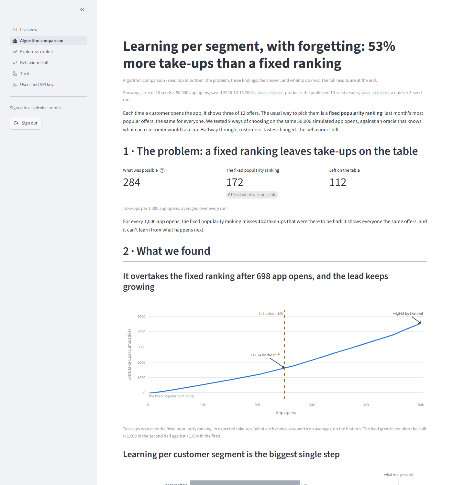
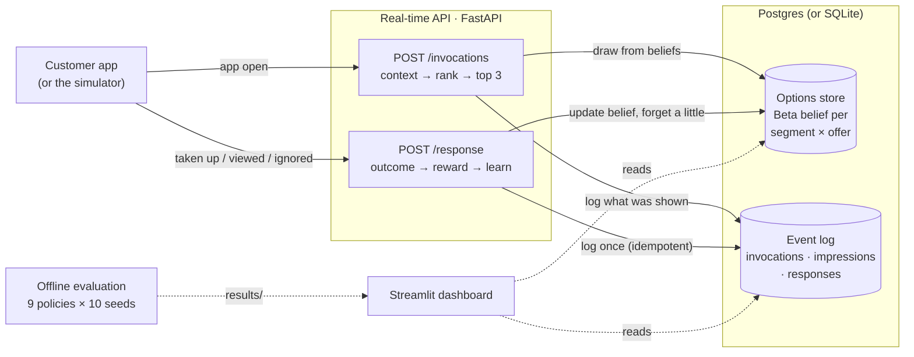

# Telco Dynamic Offer Recommender

Every time a customer opens a telco or fintech app, this system picks which three offers to show (data bundles, airtime, streaming, electricity, insurance, a pay-later voucher) and learns from what the customer does with them. A real-time API ranks offers with contextual Thompson sampling: one Beta belief per customer segment and offer, updated the moment a customer takes up, views or ignores an offer, and slowly forgetting old evidence so it keeps up when behaviour changes. A simulated South African customer base with a hidden ground truth (including payday weeks and a mid-run change in what people want) measures how much better it does than a fixed popularity ranking and than random offers, and how fast it notices the change.

Built as a portfolio project for the ecosystem.Ai technical team. It implements the same ideas (a dynamic recommender, an options store, real-time feedback, epsilon-greedy and Thompson sampling, forgetting) from scratch, in Python; it does not use ecosystem.Ai's product.

## Results

<!-- BEGIN generated:md-headline -->
- **Learning per segment beats both baselines, in every run.** thompson_segment_decay reached 92.7% of the oracle, with 53% more take-ups per app open than the static batch model (0.263 against 0.172). It cut regret by 85% against random and 81% against static: below random's regret in 10 of 10 seeds and below static's in 10 of 10.
- **It adapts when behaviour changes; the batch model does not.** After the shift its take-up rose from 0.231 to 0.295 per app open; the static model went from 0.168 to 0.175.
<!-- END generated:md-headline -->

<!-- BEGIN generated:md-results -->
| Policy | Take-up per app open | Revenue per app open | Regret (take-ups lost) | Share of oracle | Regret cut vs random | Regret cut vs static |
|---|--:|--:|--:|--:|--:|--:|
| **`thompson_segment_decay`** | 0.263 | R9.68 | 1,041 ± 39 | 92.7% | 85% | 81% |
| `thompson_segment` | 0.261 | R10.01 | 1,078 ± 166 | 92.4% | 84% | 81% |
| `thompson_segment_payday` | 0.261 | R10.16 | 1,099 ± 127 | 92.3% | 84% | 80% |
| `epsilon_greedy_segment` | 0.250 | R9.94 | 1,690 ± 381 | 88.1% | 75% | 70% |
| `thompson_segment_revenue` | 0.205 | R13.37 | 3,916 ± 92 | 72.4% | 42% | 30% |
| `thompson` | 0.193 | R5.09 | 4,582 ± 274 | 67.7% | 32% | 18% |
| `epsilon_greedy` | 0.186 | R4.97 | 4,836 ± 359 | 65.9% | 28% | 13% |
| `static` | 0.172 | R4.42 | 5,563 ± 703 | 60.8% | 17% | 0% |
| `random` | 0.149 | R5.80 | 6,728 ± 17 | 52.6% | 0% | -21% |

_50,000 app opens per run, behaviour shift at 25,000, mean ± standard deviation over 10 seeds. Regret is take-ups lost against an oracle that knows the hidden take-up probabilities._
<!-- END generated:md-results -->

Every policy faced the identical sequence of app opens and outcomes in each seed, so differences are the policies' alone. The full findings, including where the evidence shows a tie, are in [WRITEUP.md](WRITEUP.md) and on the [results page](docs/results.html).



## Quickstart

Python 3.12. No database or server needed: without a `.env`, everything uses a local SQLite file. With one, it uses your Postgres (copy `.env.example`; every setting is listed there).

**Django style, on any OS:**

```powershell
python -m venv .venv
.venv\Scripts\Activate.ps1          # macOS / Linux: source .venv/bin/activate
pip install -r requirements.txt
pip install -e .

python manage.py migrate            # the tables and the 5,000 customers
python manage.py createsuperuser    # your admin account (or create it on the dashboard's first screen)
python manage.py simulate           # results for the dashboard, 1,000 app opens through the API (~4 min)
python manage.py runserver          # API on :8000, dashboard on :8501; Ctrl+C stops both
```

Then sign in at [localhost:8501](http://localhost:8501). Keep the virtual environment outside folders that OneDrive or Dropbox sync: they lock files while pip installs. `python manage.py --help` lists every command, and the ports come from `API_PORT` and `DASHBOARD_PORT` in `.env`.

**Or with make** (Linux, macOS, or Windows with `winget install ezwinports.make`):

```bash
make install     # dependencies and the package
make simulate    # customers, a 3-seed comparison, 1,000 app opens through the API (about 4 minutes)
make dashboard   # http://localhost:8501
```

`make compare` (or `python manage.py compare`) reproduces the 10-seed results above, in about 7 minutes. `make help` lists every target.

**Or the whole system in Docker:** `docker compose up --build` starts Postgres, the API on [localhost:8000/docs](http://localhost:8000/docs) with four workers, and the dashboard on [localhost:8501](http://localhost:8501), then sends 1,000 app opens through the API so the live view fills while you watch. `docker compose down --volumes` removes it all again.

## How it works



1. **An app open** arrives with a customer ID. The API builds the context (segment, device, spend, time of day, payday week) and asks the active policy for a ranking of the offers that customer is eligible for.
2. **The policy** (`thompson_segment_decay` by default) draws one sample from each offer's Beta belief for the customer's segment and ranks by the draws. Offers it is unsure about sometimes draw high and get shown; that is the exploration.
3. **Everything shown is logged** before the response returns, with the full context, so any model can be rebuilt from the log.
4. **The outcome** comes back on `POST /response`. It is logged once (a repeat gets 409), turned into a reward (1 for a take-up, 0 for a view; ignored offers teach nothing by default), and the belief is updated in one database transaction, computed from the stored values so concurrent updates never overwrite each other. Each update also discounts the old evidence in that segment by a factor of 0.9998, so a belief built on last month's behaviour fades.
5. **The simulator** plays the customers: 5,000 synthetic South Africans in five segments, whose hidden take-up probabilities depend on segment, context and payday, and shift halfway through the run (young professionals turn to streaming, families to prepaid electricity). The policies never see these probabilities; the evaluation uses them to measure regret.

Nine policies are compared: random, a static popularity ranking fitted on a month of history, epsilon-greedy and Thompson sampling with one global belief or one per segment, and Thompson variants with payday context, forgetting, and a revenue reward. Every choice and its reasoning is in [DECISIONS.md](DECISIONS.md).

## Using the API

Start it with `python manage.py runserver` (or `make run`, or the Docker stack); interactive docs are at `/docs`.

```bash
# An app open: the top three offers for this customer, right now
curl -s -X POST localhost:8000/invocations -H "Content-Type: application/json" \
     -d '{"customer_id": "C00042"}'
```

```json
{"invocation_id": "e083ae1e-7672-45f4-8610-a7f34102b5e2", "policy": "thompson_segment_decay",
 "customer_id": "C00042",
 "context": {"segment": "small_business", "time_of_day": "evening", "is_payday_week": false, "...": "..."},
 "offers": [{"rank": 1, "offer_id": "paylater_voucher", "price_zar": 500.0, "score": 0.310, "...": "..."},
            {"rank": 2, "offer_id": "airtime_r50_bonus", "price_zar": 50.0, "score": 0.253, "...": "..."},
            {"rank": 3, "offer_id": "data_20gb", "price_zar": 449.0, "score": 0.185, "...": "..."}]}
```

```bash
# The customer took up the first offer: the model learns immediately
curl -s -X POST localhost:8000/response -H "Content-Type: application/json" \
     -d '{"invocation_id": "e083ae1e-7672-45f4-8610-a7f34102b5e2", "offer_id": "paylater_voucher", "outcome": "taken_up"}'
# {"invocation_id": "e083ae1e-…", "offer_id": "paylater_voucher", "outcome": "taken_up",
#  "policy": "thompson_segment_decay", "reward": 1.0, "model_updated": true}
# Sending the same response again returns 409: each outcome is learned from once.

# Ask a specific policy, or set the moment (payday week, time of day, a date)
curl -s -X POST "localhost:8000/invocations?policy=thompson_segment_payday" -H "Content-Type: application/json" \
     -d '{"customer_id": "C00042", "context": {"is_payday_week": true, "time_of_day": "morning"}}'

# What a policy currently believes about each offer for one segment
curl -s "localhost:8000/policies/thompson_segment_decay/state?context_key=small_business"

# Health, and p50/p95 latency per endpoint since start
curl -s localhost:8000/health
curl -s localhost:8000/metrics
```

Other endpoints: `GET /offers`, `GET /customers?segment=student`, `GET /policies`. Every response carries an `X-Response-Time-ms` header, and the server logs one JSON line per request.

## The dashboard

| Page | Shows |
|---|---|
| Live view | App opens and outcomes as they arrive, and the serving policy's current top offers per segment |
| Algorithm comparison | The findings as a data story: what a fixed ranking leaves on the table, three findings with one chart each, the answer and next steps; the full results underneath |
| Explore vs exploit | The story of exploration: how much the learner explores while unsure, how that fades, and why forgetting keeps a little doubt; the Beta beliefs underneath |
| Behaviour shift | The story of the change: how fast the learner switched to the new favourites, how take-ups followed, and what forgetting costs and saves |
| Try it (admins) | Play a customer: open the app, take up or ignore offers, and watch the belief move |
| Users and API keys (admins) | Add users, change passwords, create and revoke API keys |

Screenshots of every page are on the [dashboard docs page](docs/dashboard.html).

## Accounts and API keys

Everyone signs in to the dashboard. Accounts live in the `users` table of the project database, with passwords stored only as salted scrypt hashes.

- **Roles:** viewers see the live view and the results. Admins can also use Try it, which changes the model, and the Users and API keys page.
- **The first admin:** `python manage.py createsuperuser`. On an empty database the dashboard's first screen offers the same.
- **More accounts:** the Users and API keys page, or `python manage.py createuser NAME [--role admin]`; `changepassword NAME` resets a password.
- **A failed sign-in** takes as long as a correct one, and five failures in a row lock the browser session for 30 seconds. A sign-in lasts until the browser tab is reloaded.
- **API keys** are off by default, so a clean machine works as is. Set `RECOMMENDER_REQUIRE_API_KEY=true` in `.env`, and every endpoint except `/health` then needs an `X-API-Key` header (the interactive docs have an Authorize button). Create keys with `python manage.py createapikey --label NAME` or on the Users page. Each key is shown once and stored only as a hash. Put one in `RECOMMENDER_API_KEY` for the dashboard and simulator to send.

## Running it

- **Logs:** one JSON line per request (endpoint, status, milliseconds) and per startup, ready for any log shipper.
- **Health and metrics:** `GET /health` checks the database; `GET /metrics` gives app opens, outcomes, take-up and revenue per policy, and p50/p95 latency per endpoint.
- **Nightly job:** `make nightly` rolls yesterday's event log up into `daily_offer_stats`, one row per day, policy, segment and offer (impressions, times shown first, take-ups, views, ignores, offers with no response yet, revenue), so reports and drift alerts never scan the raw log. Days follow the configured timezone and rerunning a day replaces it, so late responses are picked up by running it again. Schedule it with cron (`5 0 * * * cd /path/to/repo && make nightly`) or one Airflow task; `make nightly ARGS=--all` backfills every day in the log. In Docker: `docker compose run --rm simulate python scripts/nightly_aggregate.py --all`.

## Configuration

| File | What it controls |
|---|---|
| `.env` | The database: `DB_HOST`, `DB_PORT`, `DB_NAME`, `DB_USER`, `DB_PASSWORD` for Postgres (see `.env.example`), or one `RECOMMENDER_DATABASE_URL`. Without either, SQLite in `data/`. |
| `config/settings.yaml` | The policy the API serves, offers per app open, the reward, and every policy's settings (context, forgetting, exploration) |
| `config/offers.yaml` | The 12 offers: price, margin, eligible segments |
| `config/simulation.yaml`, `config/ground_truth.yaml` | The simulated world: population, calendar, hidden take-up probabilities, the behaviour shift. Only the simulator reads these. |

`make db` creates the tables in the configured database; `make data` regenerates the customers.

## Project layout

```text
src/recommender/
  domain.py            offers, customers, context (payday week, time of day)
  algorithms/          random, static, epsilon-greedy, Thompson sampling, rewards
  store/               the options store: in memory, or SQL with atomic updates and forgetting
  events/              the event log (invocations, impressions, responses), nightly roll-up
  api/                 FastAPI app, schemas, request timing, API keys
  accounts.py          users and API keys: hashing, sign-in
  cli.py               the commands behind manage.py
  simulator/           population, hidden ground truth, the simulation engine
  evaluation/          regret, convergence, the multi-seed comparison
manage.py              python manage.py migrate | createsuperuser | runserver | ...
dashboard/             Streamlit app: sign-in, then one file per page
scripts/               everything the Makefile runs
config/                YAML: settings, offers, the simulated world
tests/                 pytest, from the domain model to the dashboard pages
docs/                  HTML documentation (open docs/index.html)
```

## Quality

- `make test` runs the suite: domain rules, the store under concurrent updates, every policy, the API end to end (including idempotency and, when Postgres is configured, against Postgres in a throwaway schema), the simulator, every dashboard page, and a check that the generated parts of the docs, this README and the write-up match the latest results. Tests never touch the real tables.
- `make lint` runs ruff; `make docs` regenerates the data-driven parts of the docs and of this README.
- Random seeds are fixed throughout: the same command gives the same numbers.
- `make benchmark` measures latency end to end against a real server and database. One local worker answers an app open in 11 ms at the 95th percentile with one client. In Docker Compose, four workers on the same network as Postgres keep p95 under 25 ms up to four concurrent clients, at 224 requests a second (decision Q3 explains how that was measured).

## Documentation

- [WRITEUP.md](WRITEUP.md): the problem, the approach, the results and what production would need, in two pages.
- [docs/index.html](docs/index.html): architecture, the simulated world, the policies, the API, results, the dashboard, workflows and tools, with diagrams. Open it in a browser.
- [DECISIONS.md](DECISIONS.md): every ambiguity in the brief and how it was resolved.
